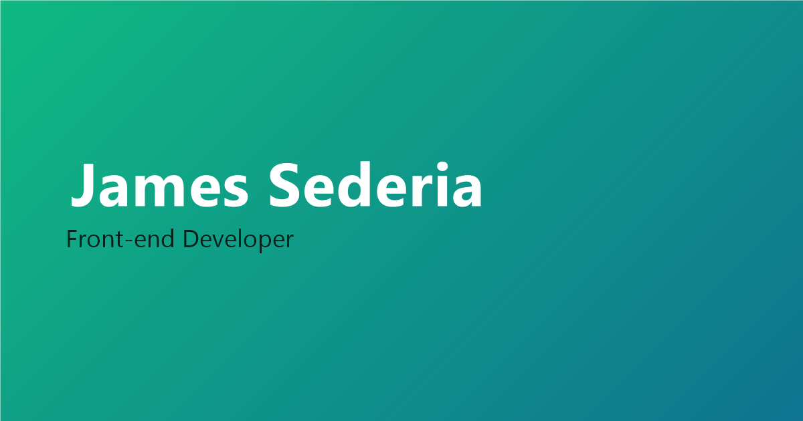

# James Sederia — Portfolio

> Personal portfolio of James Sederia — Front-end Developer & AWS Student Builder.

[](https://react.dev)
[](https://vite.dev)

**Live site:** [my-portfolio-two-hazel-51.vercel.app](https://my-portfolio-two-hazel-51.vercel.app/)



## About

This is my personal portfolio website: a fast, single-page introduction to who I am, what I've built, and how to reach me. It features my projects, tech stack, and a downloadable résumé in a clean, distraction-free layout. Built for recruiters, collaborators, and anyone curious about my work.

## Features

- **Responsive layout** — fluid type scale and a mobile dropdown menu, from phones to wide screens
- **Active-section navigation** — the navbar tracks the section currently in view and highlights one link at a time
- **Dark / light mode** — toggle in the navbar; initial theme follows your system preference and is remembered
- **Hero role animation** — cycles through my roles on load
- **Skills section** — a grid of the languages, tools, and platforms I work with
- **Projects carousel** — an interactive 3D coverflow with tech tags, demo/code links, arrow and dot controls, keyboard navigation, and swipe support
- **Scroll-reveal animations** — sections fade in as you scroll and are disabled for `prefers-reduced-motion`
- **Contact section** — direct email, GitHub, and LinkedIn links plus a required-field form
  - _Note: the form is UI-only for now. See [Known limitations](#known-limitations)._
- **Résumé download** — one-click PDF download
- **Accessibility** — skip link, semantic landmarks, ARIA labels, and visible keyboard focus styles
- **SEO & social sharing** — Open Graph and Twitter cards with a canonical URL, sitemap, and robots file

## Tech stack

| Tool | What it's for |
| --- | --- |
| [React 19](https://react.dev) | UI library |
| [Vite 8](https://vite.dev) | Dev server and production build |
| [React Router 7](https://reactrouter.com) | Routing (serves `/`, redirects everything else home) |
| [react-icons](https://react-icons.github.io/react-icons/) | Icon set (GitHub, LinkedIn, etc.) |
| [Oxlint](https://oxc.rs) | Linter |
| Plain CSS | Hand-written styles — no CSS framework |

## Getting started

### Prerequisites

- **Node.js** `^20.19.0` or `>=22.12.0` (required by Vite 8)
- npm (included with Node)

### Install and run

```bash
git clone https://github.com/james-sed/my-portfolio.git
cd my-portfolio
npm ci
npm run dev
```

`npm ci` installs the exact versions from `package-lock.json`; use `npm install` if you're intentionally changing dependencies.

The dev server starts at `http://localhost:5173` with hot module replacement.

### Commands

| Command | What it does |
| --- | --- |
| `npm run dev` | Start the dev server |
| `npm run build` | Production build into `dist/` |
| `npm run preview` | Serve the production build locally |
| `npm run lint` | Lint the project with Oxlint |

There is no automated test suite yet. Before shipping, run `npm run lint` and `npm run build`, then use the [manual QA checklist](#manual-qa-checklist).

## Project structure

```
.
├── index.html            # Entry HTML — SEO/social meta tags, Google Fonts
├── vite.config.js        # Vite configuration
├── vercel.json           # Vercel SPA rewrite
├── package.json          # Scripts and dependencies
├── public/               # Static files served as-is
│   ├── projects/         # Project cover art
│   ├── resume-sederia.pdf
│   ├── og-image.png      # Social preview image
│   ├── robots.txt
│   └── sitemap.xml
└── src/
    ├── main.jsx          # App entry — Router + ThemeProvider
    ├── App.jsx           # Routes: "/" renders Home, all other paths redirect to "/"
    ├── site.config.js    # Name, email, social links, roles, résumé path
    ├── pages/Home.jsx    # Composes all sections into one page
    ├── components/       # Navbar, Hero, About, Skills, Projects, Contact, Footer, Reveal
    ├── contexts/         # ThemeContext — dark/light mode state
    ├── data/projects.js  # Project titles, descriptions, images, tags, and links
    ├── index.css         # Design tokens, base styles, dark-mode surfaces
    └── App.css           # Component styles
```

## Editing content

- **Personal details:** update `src/site.config.js` — name, email, GitHub/LinkedIn URLs, roles, and the résumé path.
- **Projects:** update `src/data/projects.js` — title, description, image, tags, live demo, and repository URL. Replace the placeholder links/images called out in the file's comments.
- **Résumé:** replace `public/resume-sederia.pdf` (keep the filename or update `RESUME_URL` in `src/site.config.js`).
- **Images:** project screenshots live in `public/` and `public/projects/`. Update `og-image.png` if the social preview should change.
- **Colors and spacing:** edit the design tokens at the top of `src/index.css`.

## Deployment

The site is set up for **Vercel**. `vercel.json` rewrites all routes to `index.html` so client-side routing works on refresh and direct links.

- Pushing to `main` deploys production when the repository is connected to a Vercel project.
- No environment variables are currently required.
- If the production domain changes, update the canonical URL and Open Graph/Twitter URLs in `index.html`, plus `public/robots.txt` and `public/sitemap.xml`.

## Manual QA checklist

- Nav links scroll to the right section and headings clear the sticky navbar.
- The active nav link follows the section in view.
- The mobile menu opens, closes, and leaves no layout gaps.
- Dark/light mode works and survives a refresh.
- The projects carousel works with arrows, dots, keyboard arrows, and swipe.
- Keyboard focus is visible on links, buttons, and the carousel.
- The résumé link downloads the PDF.
- Layout has no horizontal overflow at phone, tablet, and desktop widths.

## Known limitations

- **The contact form does not send messages.** It validates required fields and displays a confirmation, but no email or API is connected yet.
- **Some project data is placeholder content.** Check `src/data/projects.js` for links and imagery that still need real demos or screenshots.
- **No automated tests.** Linting, the production build, and the manual checklist above are the current safeguards.

## Contact

- **Email:** [jjsederia08@gmail.com](mailto:jjsederia08@gmail.com)
- **LinkedIn:** [in/james-sederia](https://www.linkedin.com/in/james-sederia-4b87383a8)
- **GitHub:** [github.com/james-sed](https://github.com/james-sed)

## License

© James Sederia. All rights reserved.

This repository is public for viewing and reference. The code and content are not licensed for reuse.
