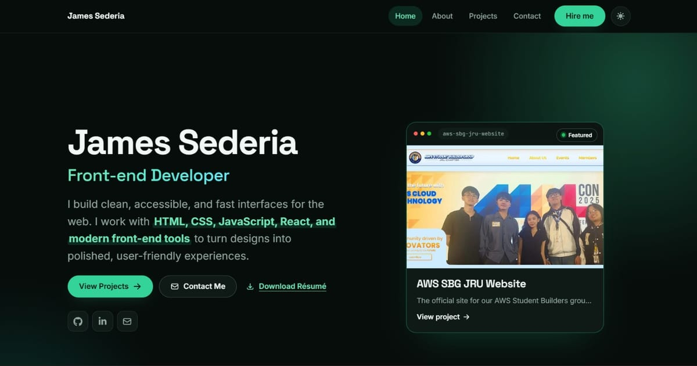

# James Sederia — Portfolio

> Personal portfolio of James Sederia — Front-end Developer & AWS Student Builder.

[](https://react.dev)
[](https://vite.dev)

**Live site:** [https://my-portfolio-jjms.vercel.app/](https://my-portfolio-jjms.vercel.app/)



## About

This is my personal portfolio website: a fast, single-page introduction to who I am, what I've built, and how to reach me. It features my projects, tech stack, and a downloadable résumé in a clean, distraction-free layout. Built for recruiters, collaborators, and anyone curious about my work.

## Features

- **Responsive layout** — fluid type scale and a mobile dropdown menu, from phones to wide screens
- **Active-section navigation** — the navbar tracks the section currently in view and highlights one link at a time
- **Dark / light mode** — toggle in the navbar; initial theme follows your system preference and is remembered
- **Hero role animation** — cycles through my roles on load
- **Skills section** — a grid of the languages, tools, and platforms I work with
- **Projects carousel** — an interactive 3D coverflow with tech tags, demo/code links, arrow and dot controls, keyboard navigation, and swipe support
- **Scroll-reveal animations** — sections fade in as you scroll and are disabled for `prefers-reduced-motion`
- **Contact section** — direct email, GitHub, and LinkedIn links plus a required-field form that emails me through [Resend](https://resend.com). The endpoint refuses cross-site posts, silently drops honeypot submissions, and rate limits per IP.
- **Résumé download** — one-click PDF download
- **Accessibility** — skip link, semantic landmarks, ARIA labels, and visible keyboard focus styles
- **SEO & social sharing** — Open Graph and Twitter cards with a canonical URL, sitemap, and robots file

## Tech stack

| Tool | What it's for |
| --- | --- |
| [React 19](https://react.dev) | UI library |
| [Vite 8](https://vite.dev) | Dev server and production build |
| [React Router 7](https://reactrouter.com) | Routing (serves `/`, redirects everything else home) |
| [react-icons](https://react-icons.github.io/react-icons/) | Icon set (GitHub, LinkedIn, etc.) |
| [Resend](https://resend.com) | Delivers contact-form email (installed from the Vercel Marketplace) |
| [Vercel Functions](https://vercel.com/docs/functions) | `/api/contact` endpoint that validates and forwards messages |
| [Oxlint](https://oxc.rs) | Linter |
| Plain CSS | Hand-written styles — no CSS framework |

## Getting started

### Prerequisites

- **Node.js** `^20.19.0` or `>=22.12.0` (required by Vite 8)
- npm (included with Node)

### Install and run

```bash
git clone https://github.com/james-sed/my-portfolio.git
cd my-portfolio
npm ci
npm run dev
```

`npm ci` installs the exact versions from `package-lock.json`; use `npm install` if you're intentionally changing dependencies.

The dev server starts at `http://localhost:5173` with hot module replacement.

### Commands

| Command | What it does |
| --- | --- |
| `npm run dev` | Start the dev server |
| `npm run build` | Production build into `dist/` |
| `npm run preview` | Serve the production build locally |
| `npm run lint` | Lint the project with Oxlint |

There is no automated test suite yet. Before shipping, run `npm run lint` and `npm run build`, then use the [manual QA checklist](#manual-qa-checklist).

## Project structure

```
.
├── api/contact.js        # Contact form endpoint — validates, then sends via Resend
├── backup/               # Original JPEGs replaced by the WebP covers (not served)
├── shared/contact-limits.js  # Contact rules (field limits, email pattern) shared by app + API
├── public/               # Static files served as-is
│   ├── *.webp            # Six project covers
│   ├── portfolio-preview.jpg   # Social preview (1200×630)
│   ├── professional-pic-james.jpg
│   ├── resume-sederia.pdf
│   ├── favicon.svg, icon-*.png, apple-touch-icon.png, site.webmanifest
│   └── robots.txt, sitemap.xml
├── src/
│   ├── assets/           # Unreferenced images (not bundled)
│   ├── components/       # Navbar, Hero, About, Skills, Projects, Contact, Footer, Reveal
│   ├── contexts/         # ThemeProvider + theme-context (state, hook, OS-follow)
│   ├── data/projects.js  # Project titles, descriptions, images, tags, and links
│   ├── pages/Home.jsx    # Composes all sections into one page
│   ├── App.css           # Component styles
│   ├── App.jsx           # Routes: "/" renders Home, all other paths redirect to "/"
│   ├── index.css         # Design tokens, base styles, dark-mode surfaces
│   ├── main.jsx          # App entry — Router + ThemeProvider
│   └── site.config.js    # Name, email, social links, roles, résumé path
├── index.html            # Entry HTML — SEO/social meta tags, Google Fonts
├── package.json          # Scripts and dependencies
├── .oxlintrc.json        # Linter configuration
├── vercel.json           # Vercel config (no SPA catch-all; unknown paths 404)
└── vite.config.js        # Vite configuration (also serves /api locally)
```

## Editing content

- **Personal details:** update `src/site.config.js` — name, email, GitHub/LinkedIn URLs, roles, and the résumé path.
- **Projects:** update `src/data/projects.js` — title, description, image, tags, live demo, and repository URL. A `live` value equal to `GITHUB_URL` hides the "Live demo" button.
- **Contact rules:** `shared/contact-limits.js` holds the field limits and email pattern; both the form and `api/contact.js` import it, so edit it once.
- **Résumé:** replace `public/resume-sederia.pdf` (keep the filename or update `RESUME_URL` in `src/site.config.js`).
- **Images:** project screenshots live in `public/` as WebP files. The social preview is `public/portfolio-preview.jpg`, cropped to the 1200×630 box declared in `index.html` — keep those two in sync if you replace it.
- **Colors and spacing:** edit the design tokens at the top of `src/index.css`.

## Deployment

The site is set up for **Vercel**. There is deliberately no catch-all rewrite: the app only serves `/` (all in-page navigation uses hashes), so unknown paths and missing assets return a real 404 instead of a 200 page of HTML. If you add client-side routes later, restore a rewrite in `vercel.json`.

- Pushing to `main` deploys production when the repository is connected to a Vercel project.
- The contact endpoint reads `RESEND_API_KEY`, which the Resend Marketplace integration adds to every environment automatically. Run `vercel env pull` to copy it into `.env.local` for local development; `npm run dev` serves `/api/contact` too.
- Optional overrides: `CONTACT_TO` (defaults to the address in `api/contact.js`) and `CONTACT_FROM` (defaults to `Portfolio Contact <onboarding@resend.dev>`).
- Abuse protection: `api/contact.js` caps each IP at 5 submissions per 10 minutes and rejects cross-site or honeypot-filled posts. A Vercel Firewall rule rate limits `/api/contact` to 10 requests per minute per IP; check it with `vercel firewall rules list`.
- If the production domain changes, update the canonical URL and Open Graph/Twitter URLs in `index.html`, plus `public/robots.txt` and `public/sitemap.xml`.

## Manual QA checklist

- Nav links scroll to the right section and headings clear the sticky navbar.
- The active nav link follows the section in view.
- The mobile menu opens, closes, and leaves no layout gaps.
- Dark/light mode works and survives a refresh.
- The projects carousel works with arrows, dots, keyboard arrows, and swipe.
- Swiping the centered project card rotates once and does not open its links.
- Keyboard focus is visible on links, buttons, and the carousel.
- The résumé link downloads the PDF.
- The contact form rejects an invalid email address and delivers a real message.
- Layout has no horizontal overflow at phone, tablet, and desktop widths.

## Known limitations

- **Contact email is sent from `onboarding@resend.dev` until `jamessederia.dev` is verified in Resend.** Add the DKIM TXT and the `send` / `rsend` CNAME records shown in the Resend dashboard, then set `CONTACT_FROM` to an address on that domain.
- **Four projects have no live demo yet.** Their `live` value is `GITHUB_URL`, so the card hides the button. Replace it in `src/data/projects.js` once each one is deployed.
- **No automated tests.** Linting, the production build, and the manual checklist above are the current safeguards.

## Contact

- **Email:** [jjsederia08@gmail.com](mailto:jjsederia08@gmail.com)
- **LinkedIn:** [in/james-sederia](https://www.linkedin.com/in/james-sederia-4b87383a8)
- **GitHub:** [github.com/james-sed](https://github.com/james-sed)

## License

© James Sederia. All rights reserved.

This repository is public for viewing and reference. The code and content are not licensed for reuse.
